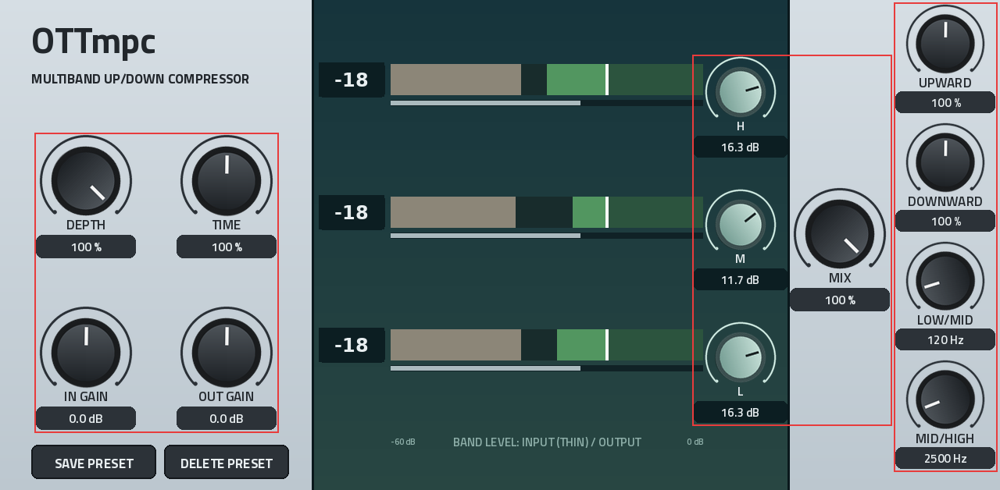

# OTTmpc

**Vital's OTT multiband compressor as an insert effect for MPC and Force.**

OTTmpc squeezes the loud parts down and lifts the quiet parts up, in three bands at once: the classic "OTT" sound,
as a native effect on a track, with its own touchscreen skin, smooth band meters, ten presets and your own.

## Features

- Three-band up/down compression (the OTT algorithm from Vital), with the Low/Mid and Mid/High crossovers adjustable.
- **Band meters**: for each band a thin input strip and a smooth output bar over the band's upward (beige) and downward
  (green) zones, with a peak-hold line and the output level as a dB number.
- **12 controls** on the Q-Links, in three blocks of four:

  | Control | Range | What it does |
  |---|---|---|
  | Depth | 0 to 100 % | Overall amount of compression. 0 leaves the band gains only. |
  | Time | 0 to 200 % | Attack and release together: lower is faster. |
  | In Gain / Out Gain | -30 to +30 dB | Level into and out of the compressor. |
  | High / Mid / Low gain | -30 to +30 dB | Make-up gain per band. |
  | Mix | 0 to 100 % | Dry/wet, for parallel compression. |
  | Upward | 0 to 200 % | How hard quiet material is lifted. |
  | Downward | 0 to 200 % | How hard loud material is pushed down. |
  | Low/Mid, Mid/High | 20 to 1000 Hz, 1 to 18 kHz | The two crossover frequencies. |

- **10 presets** in MPC's PRESET menu: OTT Default, Flat (Bypass-ish), Gentle Glue, Parallel Smash, Upward Only,
  Downward Only, Drum Bus, Vocal Air, Bass Tighten and Lo-Fi Squash.
- **Your own presets** in the same menu (U01 to U32): SAVE PRESET names the current settings on an on-screen keyboard,
  DELETE PRESET removes the picked one. They are shared by every project.
- **Settings are saved with your project**, including the preset you picked.
- Runs at the project's sample rate, and its output is no longer clipped at 0 dBFS inside the plugin.

## Install

Through the MPC's Plugin Manager, or by hand with root SSH:

- `OTTmpc-2.0.0-mpc-aarch64.zip`: the 64-bit MPCs (Live III and others).
- `OTTmpc-2.0.0-mpc-armv7.zip`: the Force and the 32-bit MPCs (Live, Live II, One, X, Key 61).
- `OTTmpc-2.0.0-mpc-sdk.zip`: one folder for every MPC (MPC OS 3.10.1 and later): copy it into the drive's `VST2 Plugins` folder.

Unzip it, copy the folder to the device and run its `install.sh` (it stops MPC, so save your project first). It upgrades
an installed OTTmpc 1.0 in place and keeps your user presets on later upgrades. The zip's `INSTALL.md` has the details.
MPC OS 3.x is needed (the skin format). Installing plugins this way is unofficial: back up first.

## Using it

Start with **OTT Default** and bring **Depth** up or down to taste. **Mix** below 100 % blends the original back in
(parallel compression). **Upward** and **Downward** shape the two halves of the sound separately. Drum Bus, Vocal Air and
Bass Tighten are good starting points for those sources.

Picking a preset in the PRESET menu sets all 12 controls. To keep a sound, tap **SAVE PRESET**, type a name (up to 20
characters) and tap **SAVE**: it appears as `U01 <name>`. **DELETE PRESET** removes the user preset that is picked.

## Upgrading from 1.0

Projects, automation and Q-Link assignments from 1.0 load in 2.0. OTTmpc 1.0 did not save its settings in a project (a
bug: closing and reopening a project lost them), so a 1.0 project opens with the factory preset it had picked and the
default settings otherwise. Projects saved with 2.0 keep everything.

## Credits and licence

OTTmpc is built on other people's work:

- [vitOTTx](https://github.com/Sakhnovkrg/vitOTTx) by Sakhnovkrg: the OTT plugin whose DSP and parameter behaviour this port follows.
- vitOTT by Yegor Suslin, which vitOTTx is based on.
- [Vital](https://github.com/mtytel/vital) by Matt Tytel: the compressor and filter code underneath.
- [mpc-vst-plugins](https://github.com/sd88me/mpc-vst-plugins): the tools the 1.x build was made with.
- Titillium Web (SIL Open Font License, `tools/fonts/OFL.txt`) for the skin's captions.

Licence: **GPL-3.0** (`LICENSE`), as the upstream code.

## For developers

- `src/vital_dsp/` is Vital's DSP, vendored from vitOTTx (`src/VENDORED.md` lists the local changes). `src/engine.cpp` is
  the glue that follows vitOTTx's parameter mapping; `src/OTTPlugin.cpp` is the plugin around it.
- `params.lock` is the parameter order: 1.0's 18 first, new ones appended only. `tools/gen_params.py` makes
  `src/params_gen.h` from `vst/params.json` and `vst/presets.json`; `tools/make_tui.py` makes the skin in `skins/` from the
  1.x art (`vst/art/make_art.py`).
- Build with the MPC plugin builder (`MPC_BUILDER=<checkout>`):

      ./build.sh test     # build both CPUs, the offline ASan/UBSan host test (tests/run.sh) and the builder's host check
      ./build.sh beta     # "OTTmpc 2 Beta", its own uid, installs next to the release
      tools/package_catalog.sh   # the two release zips in dist/

- `tests/check_legacy.sh` builds the 1.0.1 release and shows its saved state was empty.
